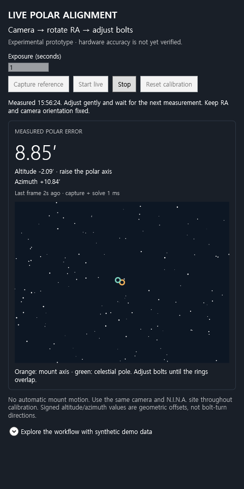

# N.I.N.A. Live Polar Alignment

두 번의 기준 촬영 후 이미지 위 표시를 보며 적도의의 고도·방위각을 조정하는 N.I.N.A. 플러그인입니다.
SharpCap의 직관적인 조정 흐름을 참고하여 자체 C# 코드로 구현하고 있습니다.

**현재 상태: 장비 검증 전 실험용 프로토타입.** 촬영·plate solve·정렬 계산·안내 화면은 연결했지만,
실제 장비에서의 정확도와 SharpCap 수준의 갱신 속도는 아직 검증하지 않았습니다.

## 사용 흐름

1. N.I.N.A.에 카메라를 연결하고 관측지, 초점거리, 픽셀 크기, plate solver를 설정합니다.
2. 해당 반구 천구극에서 15° 이내를 촬영하여 첫 기준을 잡습니다.
3. **고도·방위각은 그대로 두고 RA만 60–90° 회전**한 뒤 두 번째 기준을 촬영합니다. 최소 30°가 필요합니다.
4. `Start live`를 누르고, 고도·방위각 볼트를 조정해 주황색 극축 표시와 초록색 천구극 표시를 겹칩니다.
5. `Stop`으로 촬영을 중단합니다. 카메라 방향·설정이나 관측지를 바꿨다면 보정을 다시 시작합니다.

자동 이동·mount sync는 하지 않습니다. 조정 중 RA/Dec와 카메라 장착 상태를 유지해야 합니다.
오차 부호는 기하학적 고도·방위각 차이이며 볼트를 돌리는 방향이 아닙니다.
대기 굴절 보정은 아직 적용하지 않습니다. 위도 절댓값 1–89.5°에서 시작할 수 있습니다.
`Explore the workflow`에는 장비와 분리된 합성 데이터 데모가 있습니다.

## 개발

```powershell
.\scripts\bootstrap.ps1
.\scripts\rea.ps1 --version
dotnet build src/Nina.LivePolarAlignment -c Release
dotnet test tests/Nina.LivePolarAlignment.Core.Tests -c Release
dotnet test tests/Nina.LivePolarAlignment.Integration.Tests -c Release
```

Node 24.22.0과 REA 6.5.0을 `.tools` 아래에 설치합니다. 전역 Node는 변경하지 않습니다.
bootstrap은 Codex 설정을 수정하지 않습니다. MCP 등록은 REA setup으로 별도 관리합니다.

Windows, .NET 8 SDK 및 Desktop Runtime이 필요합니다. N.I.N.A. API는 `NINA.Plugin 3.2.0.9001`을 대상으로 합니다.
전이 의존성 `ToastNotifications`, `VVVV.FreeImage`의 NU1701 경고가 있습니다.
통합 테스트는 설치된 N.I.N.A.의 x64 SOFA/NOVAS 라이브러리를 사용합니다.
설치 경로 변경 방법은 [통합 테스트 안내](tests/Nina.LivePolarAlignment.Integration.Tests/README.md)를 참고하세요.

로컬 설치 시 N.I.N.A.를 종료하고 Release 출력의 `Nina.LivePolarAlignment.dll`과
`Nina.LivePolarAlignment.Core.dll`을 `%LOCALAPPDATA%\NINA\Plugins\3.0.0\Live Polar Alignment`에 함께 복사합니다.
재시작 후 이미징 화면의 플러그인 도킹 패널에서 `Live Polar Alignment`를 엽니다.

## 갱신 속도

현재 촬영 경로는 설정된 N.I.N.A. solver로 매 프레임을 해석합니다. 노출·다운로드·solver 시간이 갱신 속도를 결정합니다.
빠른 별 정합 코어도 구현했지만 실제 촬영 경로에 연결하기 전입니다. 코어 연산 시간만으로 전체 갱신 속도를 주장하지 않습니다.
다음 단계는 극 주변의 빠른 해석 또는 검증된 별 정합 경로를 연결하고 실패 시 재해석하도록 만드는 것입니다.

## 화면 미리보기



합성 입력 화면입니다. 표시된 처리 시간은 가짜 입력 공급 시간을 포함하며 실제 촬영·solver 성능이 아닙니다.

## 분석

```powershell
.\scripts\rea.ps1 inspect-managed-artifact 'C:\path\SharpCap.exe' --json
.\scripts\rea.ps1 inspect-managed-members 'C:\path\SharpCap.exe' --type 'Exact.Namespace.Type' --json
```

설치 프로그램과 실제 .NET 어셈블리를 구분해야 합니다. 네이티브 구성 요소는 별도 분석 엔진이 필요합니다.
분석 계획과 근거는 [docs/research-plan.md](docs/research-plan.md)를 참고하세요.
현재 PC에서의 설치 및 분석 결과는 [docs/initial-findings.md](docs/initial-findings.md)에 기록했습니다.
후속 [SharpCap 분석 결과](docs/sharpcap-polar-findings.md)에는 실제 기능 어셈블리의 근거와 구현 범위를 정리했습니다.
대상 바이너리·복원 소스·전체 Evidence는 로컬 `analysis`에만 보관하며 Git에 포함하지 않습니다.
