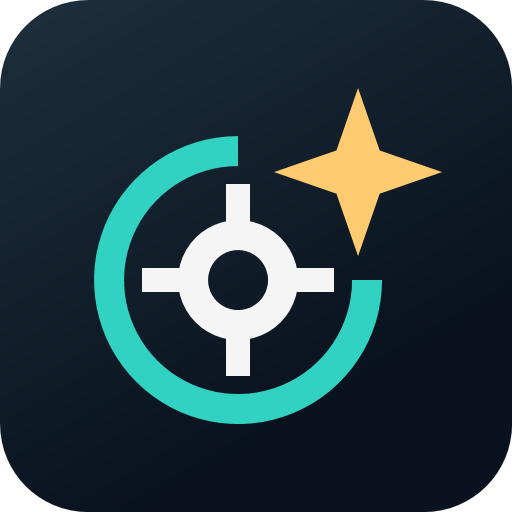

# N.I.N.A. Live Polar Alignment



두 번의 기준 촬영 후 이미지 위 표시를 보며 적도의의 고도·방위각을 조정하는 N.I.N.A. 플러그인입니다.
SharpCap의 직관적인 조정 흐름을 참고하여 자체 C# 코드로 구현하고 있습니다.

**현재 상태: 장비 검증 전 실험용 프로토타입.** 촬영·plate solve·정렬 계산·안내 화면은 연결했지만,
실제 장비에서의 정확도와 SharpCap 수준의 갱신 속도는 아직 검증하지 않았습니다.

## 배포본 설치

[0.1.0.18 ZIP 다운로드](https://github.com/squallseo/Nina.LivePolarAlignment/raw/refs/heads/feature/live-polar-alignment/downloads/Nina.LivePolarAlignment.0.1.0.18.zip) · [SHA256](downloads/Nina.LivePolarAlignment.0.1.0.18.zip.sha256)

Windows x64와 N.I.N.A. 3.2.0.9001 이상이 필요합니다. ZIP을 모두 풀고 N.I.N.A.를 종료한 뒤 `Install-Plugin.ps1`을 실행하거나, `plugin` 폴더 내용을 아래 로컬 설치 경로에 복사하세요. SDK나 소스 빌드는 필요하지 않습니다.

`Plugins → Installed → Live Polar Alignment → Options`에서 **Enable debug recording**을 켜면 현장 검증 자료를 기록합니다. 기본은 꺼짐이며 프로필별로 저장합니다. 다음 기준 촬영부터 적용하므로 이미 정렬 중이면 Reset 후 시작하세요. [설치 안내](docs/install-package.txt)

## 사용 흐름

1. N.I.N.A.에 카메라를 연결하고 관측지, 초점거리, 픽셀 크기, plate solver를 설정합니다.
2. 해당 반구 천구극에서 15° 이내를 촬영하여 첫 기준을 잡습니다.
3. **고도·방위각은 그대로 두고 RA만 60–90° 회전**한 뒤 두 번째 기준을 촬영합니다. 최소 30°가 필요합니다.
4. `실시간 조정 시작`을 누르고, 고도·방위각 볼트를 조정해 주황색 RA 회전 중심과 청록색 천구극 표시를 겹칩니다.
5. `중지`로 촬영을 중단합니다. 카메라 방향·설정이나 관측지를 바꿨다면 `다시`로 기준을 초기화합니다.

자동 RA 회전은 기본 ON입니다. 실행 시 미지원 장비이면 알림창 없이 OFF로 전환하고 수동 회전을 안내합니다. `Auto RA rotation`을 켜면 첫 촬영 → RA 선택한 60–90° 회전 → 두 번째 촬영을 자동으로 수행합니다. 방향을 선택하고 경로의 간섭 여부를 확인한 뒤 시작하세요. 지원하지 않는 마운트는 수동 방식으로 진행합니다. [자동 RA 회전 안내](docs/auto-ra-rotation.md)

좌표 GoTo·mount sync·자동 주차 해제·자동 복귀는 하지 않습니다. 볼트 조정 중 RA/Dec와 카메라 장착 상태를 유지해야 합니다.
오차 부호는 기하학적 고도·방위각 차이이며 볼트를 돌리는 방향이 아닙니다.
대기 굴절 보정은 아직 적용하지 않습니다. 위도 절댓값 1–89.5°에서 시작할 수 있습니다.
장비 없는 합성 데모는 아래의 독립 미리보기에서 실행합니다.

화면은 기준 촬영 → RA 회전 → 볼트 조정의 세 단계로 안내합니다. 첫 기준에서 천구극과 각거리 원을 표시하고,
두 번째 촬영 이후 RA 회전 중심과 측정 회전량을 표시합니다. RA 그림은 권장 회전 안내이며 실시간 엔코더가 아닙니다.
넓은 창에서는 하늘 영상을 왼쪽에 최대한 크게, 조작 패널을 오른쪽에 배치합니다.
가운데 경계선을 끌어 패널 너비를 조절할 수 있고, 좁은 도킹 패널에서는 위아래 배치로 전환됩니다.
오차값 아래의 확대 뷰는 천구극 목표점을 중앙에 고정하고 메인 영상보다 최소 2배 크게 표시합니다. RA축이 멀어져도 배율을 낮추지 않으며, 확대 범위 밖의 RA축은 가장자리 화살표로 안내합니다. 별을 새로 그리거나 북극성으로 식별한 표시는 아닙니다. 측정 전·중지·오래된 측정에서는 확대 뷰를 숨깁니다.
방향 안내는 천구극을 바라보고 섰을 때 경통 끝이 움직일 방향입니다.
현재는 천구극과 RA 회전 중심을 표시하며, 북극성 자체의 식별 표시나 기준 별→목표점 화살표는 아직 구현하지 않았습니다.

## 현장 검증

`Independent drift verification`에서 천구 적도 근처의 두 위치를 직접 선택하고 추적 중 Dec 드리프트를 관측하는 별도 검사도 사용할 수 있습니다. 재측정·Stability·드리프트 결과를 종합해 재정렬 권고, 검사 불일치, 판정 불가 등을 표시합니다. 기본 목표는 60″이며 변경할 수 있습니다. [독립 검증과 판정 안내](docs/independent-drift.md)

정렬 후 `Verify alignment`에서 새 기준 두 장과 **추가 RA 60–90° 회전**으로 선택적으로 재측정할 수 있습니다. Dec와 볼트는 고정합니다. 재측정 뒤 Stability 20프레임은 기본 자동이며 옵션으로 끌 수 있습니다. 일반 실시간 조정 중 Stability는 수동 시작입니다. 디버그 파일 기록 없이도 사용할 수 있습니다. [재측정 안내](docs/verification.md)

우측 `Field validation`에서 자동 세션 기록, `Mark` 원본·메모 저장, `Stability` 20프레임 반복성 검사를 사용할 수 있습니다.
현장에서는 [검증 절차와 오프라인 분석 안내](docs/field-validation.md)를 따라 기록하고 세션 폴더 전체를 보관하세요.
반복성은 절대 정확도와 구분합니다.

## 개발

```powershell
.\scripts\bootstrap.ps1
.\scripts\rea.ps1 --version
dotnet build src/Nina.LivePolarAlignment -c Release
dotnet test tests/Nina.LivePolarAlignment.Core.Tests -c Release
dotnet test tests/Nina.LivePolarAlignment.Integration.Tests -c Release
```

Node 24.22.0과 REA 6.5.0을 `.tools` 아래에 설치합니다. 전역 Node는 변경하지 않습니다.
bootstrap은 Codex 설정을 수정하지 않습니다. MCP 등록은 REA setup으로 별도 관리합니다.

Windows, .NET 8 SDK 및 Desktop Runtime이 필요합니다. N.I.N.A. API는 `NINA.Plugin 3.2.0.9001`을 대상으로 합니다.
전이 의존성 `ToastNotifications`, `VVVV.FreeImage`의 NU1701 경고가 있습니다.
통합 테스트는 설치된 N.I.N.A.의 x64 SOFA/NOVAS 라이브러리를 사용합니다.
설치 경로 변경 방법은 [통합 테스트 안내](tests/Nina.LivePolarAlignment.Integration.Tests/README.md)를 참고하세요.

로컬 설치 시 N.I.N.A.를 종료하고 Release 출력의 `Nina.LivePolarAlignment.dll`과
`Nina.LivePolarAlignment.Core.dll`을 `%LOCALAPPDATA%\NINA\Plugins\3.0.0\Live Polar Alignment`에 함께 복사합니다.
한국어 리소스 사용 시 `ko-KR\Nina.LivePolarAlignment.resources.dll`도 같은 상대 경로로 복사합니다.
재시작 후 이미징 화면의 플러그인 도킹 패널에서 `Live Polar Alignment`를 엽니다.

## 갱신 속도

스트리밍은 기본 ON이며, 미지원 또는 스트림 시작·수신 실패 시 알림창 없이 OFF로 전환하고 단일 촬영을 이어갑니다. `Streaming` 옵션을 켜면 조정 단계에서 네이티브 RAW 스트리밍을 사용합니다. 초기 두 기준은 항상 단일 촬영합니다. 지원 범위는 네이티브 ZWO ASI·ToupTek이며, ASCOM 등 미지원 경로도 옵션을 선택할 수 있으며 실행 시 일반 촬영으로 전환합니다.

스트리밍은 촬영과 해석을 겹치고 최신 프레임만 유지하지만, 표시하는 모든 측정에는 여전히 Plate Solve가 필요합니다. 해석이 느리면 효과가 제한됩니다. 실제 장비의 속도·정확도는 검증 전입니다. 영상 프레임의 노출 시각도 수신 시각 기반 추정치입니다. [검토와 구현 범위](docs/streaming-review.md)를 참고하세요.
빠른 별 정합 코어도 구현했지만 실제 촬영 경로에 연결하기 전입니다. 코어 연산 시간만으로 전체 갱신 속도를 주장하지 않습니다.
다음 단계는 극 주변의 빠른 해석 또는 검증된 별 정합 경로를 연결하고 실패 시 재해석하도록 만드는 것입니다.

## 화면 미리보기

빈 영상 화면은 N.I.N.A. 기본 이미지 뷰와 같은 테마 배경·PictureSVG 아이콘·`No image` 문구를 사용합니다.


합성 입력 화면입니다. 표시된 처리 시간은 가짜 입력 공급 시간을 포함하며 실제 촬영·solver 성능이 아닙니다.

장비 없이 실제 WPF 화면을 실행하려면:

```powershell
dotnet run --project tools/Nina.LivePolarAlignment.Preview -c Release
```

미리보기는 최대화된 창으로 열리며 상단에서 첫 화면·RA 회전·조정 화면을 선택할 수 있습니다.
[독립 미리보기 안내](tools/Nina.LivePolarAlignment.Preview/README.md)를 참고하세요.

## 분석

```powershell
.\scripts\rea.ps1 inspect-managed-artifact 'C:\path\SharpCap.exe' --json
.\scripts\rea.ps1 inspect-managed-members 'C:\path\SharpCap.exe' --type 'Exact.Namespace.Type' --json
```

설치 프로그램과 실제 .NET 어셈블리를 구분해야 합니다. 네이티브 구성 요소는 별도 분석 엔진이 필요합니다.
분석 계획과 근거는 [docs/research-plan.md](docs/research-plan.md)를 참고하세요.
현재 PC에서의 설치 및 분석 결과는 [docs/initial-findings.md](docs/initial-findings.md)에 기록했습니다.
후속 [SharpCap 분석 결과](docs/sharpcap-polar-findings.md)에는 실제 기능 어셈블리의 근거와 구현 범위를 정리했습니다.
대상 바이너리·복원 소스·전체 Evidence는 로컬 `analysis`에만 보관하며 Git에 포함하지 않습니다.
