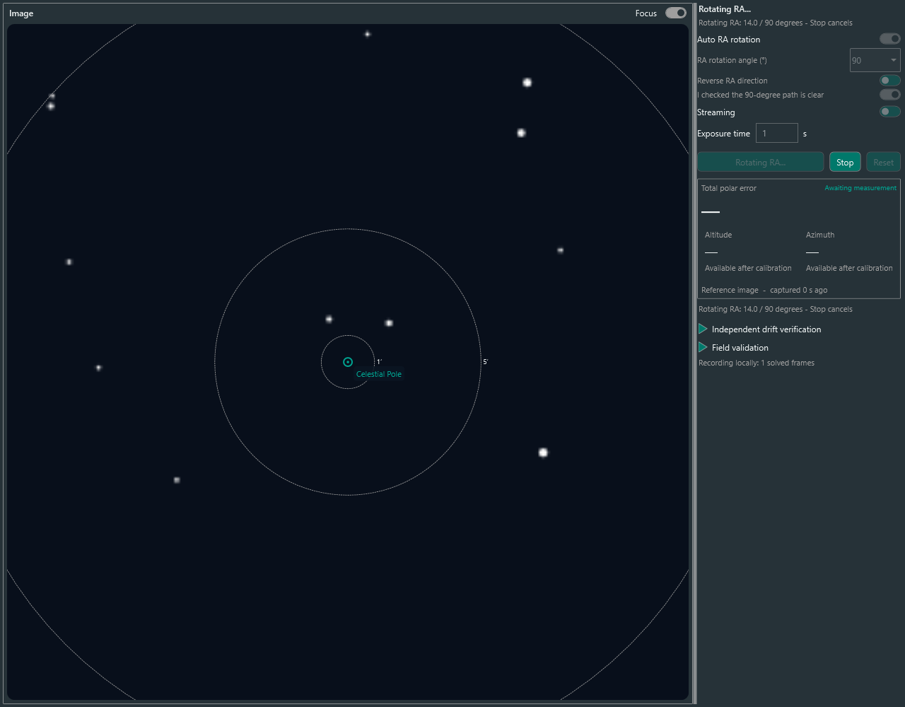

# 자동 RA 회전 — 실험 기능

0.1.0.8부터 이미징 패널의 `Auto RA rotation`을 켜면 첫 기준 촬영 → RA 선택한 60° 또는 90° 회전 → 정지 확인 및 안정 대기 → 두 번째 기준 촬영을 자동 수행합니다. 이후 `Start live adjustment`로 측정하며 고도·방위각 볼트만 사람이 조정합니다.

0.1.0.13부터 기본 ON입니다. 장비 연결 전에도 선택할 수 있고, 실행 시 미지원이면 조용히 OFF로 전환해 수동 회전을 안내합니다. 실제 회전 중 오류는 정지·초기화 후 표시합니다. 첫 기준을 이미 촬영한 상태에서도 자동 옵션을 선택해 회전과 두 번째 촬영을 수행할 수 있습니다. 지원되지 않으면 기존 수동 RA 60–90° 방식으로 진행하세요.

## 사용 전

- 카메라·solver·별 데이터베이스·관측지·초점거리·픽셀 크기를 설정합니다. 천구극 근처로 직접 향하게 합니다.
- 마운트를 연결하고 주차를 해제합니다. 다른 시퀀스·가이딩·수동 이동은 중단하세요. 플러그인은 자동으로 주차 해제하지 않습니다.
- 적도의 모드, RA축 `MoveAxis`, 추적 ON/OFF 제어, 0.1–1°/s 범위의 지원 속도가 필요합니다. AltAz는 지원하지 않습니다.
- `Reverse RA direction`은 N.I.N.A. 수동 축 이동 방향을 반전합니다. `PrimaryReversed` 설정도 적용됩니다. +/−가 물리적으로 어느 방향인지는 드라이버·설치 상태에 따라 달라집니다.
- 선택한 방향으로 **선택한 60° 또는 90°와 정지 여유**를 확인하세요. 경통·삼각대·케이블·마운트 한계와 자오선 부근의 이동을 직접 확인한 후 `I checked the 60/90-degree path is clear`를 켭니다. 이 확인은 Reset·각도 변경·방향 변경·자동 회전 종료 시 해제됩니다.

## 동작과 중지

RA축만 움직이며 Dec축 이동·GoTo·sync·meridian flip·자동 복귀 명령은 보내지 않습니다. 잠시 추적을 끄고 허용 속도 중 최대 1°/s를 선택합니다. RA 좌표 변화량을 24시간 경계에서 풀어 합산하며 선택한 60° 또는 90°에서 정지합니다. 피드백·드라이버 지연으로 정확히 60.000°에 멈추는 것은 아닙니다. 실제 보정에는 두 영상에서 계산한 회전량을 사용합니다.

`Stop`, 패널 닫기·숨기기 시 취소를 요청합니다. 0속도 명령을 보내고, 정지 피드백 확인 후 원래 추적 ON/OFF를 복원합니다. 이후 2초 기다린 다음 두 번째 촬영을 합니다. 정지 실패 시 abort를 시도하고 오류를 표시하며, 확인되지 않은 상태에서 추적을 다시 켜지 않습니다.

6초 동안 이동 응답이 없거나 전체 제한 시간을 넘으면 중단합니다. 연결·Dec·pier side 변화, 비정상 좌표 변화도 중단 조건입니다. 중간 회전 실패·취소는 첫 기준을 폐기하므로 다시 기준을 촬영해야 합니다. 회전 완료 후 두 번째 영상의 solve만 실패했다면 재촬영 때 회전을 반복하지 않습니다.

## 현장 검증 범위

현재 검증은 가짜 장비를 이용한 단위·통합 테스트와 실제 WPF 화면에서의 합성 입력 검증입니다. **실제 적도의의 이동·정지·정확도는 검증 전입니다.** 첫 현장 사용은 이동 여유가 충분한 상태에서 직접 관찰하며 진행하세요.

드라이버가 멈추거나 좌표·Slewing 상태를 잘못 보고하면 소프트웨어의 정지 확인에도 한계가 있습니다. 프로그램 종료·PC 정지 상황을 위한 독립적인 하드웨어 정지 기능은 제공하지 않습니다. 장비 컨트롤러의 정지 수단을 사용할 수 있어야 합니다. 이 플러그인은 모델 기반 충돌 회피나 케이블·기계 한계 검출을 하지 않습니다.

디버그 기록을 켜면 회전 시작·완료·실패와 기준 영상 데이터가 같은 세션에 기록됩니다. 실패·취소로 기준을 폐기하면 해당 세션을 닫고 다음 시도는 별도 폴더로 기록합니다.

0.1.0.11부터 `RA rotation angle (°)`에서 90°(기본값) 또는 60°를 선택할 수 있습니다. 재측정에도 같은 각도를 사용하며, 각도를 바꾸면 경로 확인을 다시 해야 합니다.

## 회전 각도 선택 근거

0.1.0.14부터 각도 선택은 자동 RA 회전이 켜져 있을 때만 표시됩니다. 기본값은 90°이며 60°는 회전 범위가 제한된 경우의 대안입니다. 자동 재측정도 선택한 각도로 회전하므로 재측정 패널에는 각도 설정이 표시됩니다.

[SharpCap 공식 Polar Alignment 설명](https://docs.sharpcap.co.uk/4.1/9_PolarAlignment.htm)은 일반 절차에서 약 90°를 권장합니다. 같은 문서의 장애물·처짐 관련 안내에서는 수직에서 왼쪽 30–40°와 오른쪽 30–40° 사이, 즉 총 60–80° 회전하는 방법도 제시합니다. 이는 60°를 대안으로 남기는 근거이며, 60°가 90°와 같은 정밀도를 보장한다는 뜻은 아닙니다.

현재 구현은 두 촬영의 실제 자세 차이에서 RA 회전축을 추정하므로 정확히 90°여야 계산되는 방식은 아닙니다. 일반적으로 작은 회전은 같은 자세 측정 오차에 더 민감합니다. 60°/90°의 현장 정밀도 비교는 아직 수행하지 않았으며, 제약이 없으면 90°를 사용합니다.