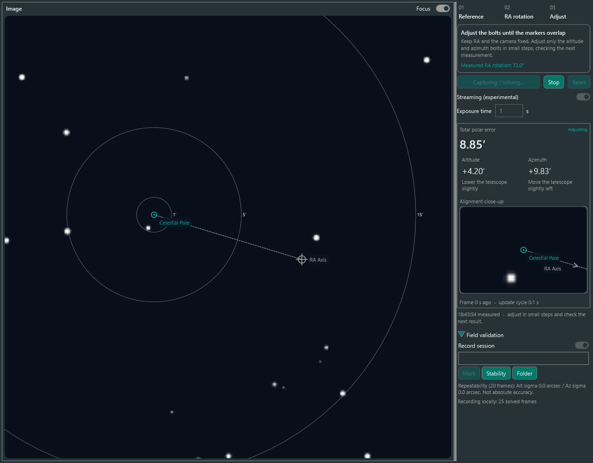

# 현장 검증

플러그인 0.1.0.5부터 `Plugins → Installed → Live Polar Alignment → Options`의 **Enable debug recording**을 켜 검증 자료를 남길 수 있습니다. UI 언어는 N.I.N.A. 설정을 따릅니다. 기록은 기본 꺼짐이며 프로필별로 저장합니다. 첫 기준 촬영부터 기록하므로 이미 기준을 잡았다면 Reset 후 다시 시작하세요. 우측 `Field validation`에는 Mark·Stability·Folder가 있습니다. 현장 정확도는 아직 검증 전입니다.

## 현장에서

1. PC 시각, 관측지 좌표, 초점거리, 픽셀 크기, solver를 확인합니다. 메모에 카메라·렌즈·마운트, 추적 ON/OFF, 노출, 날씨를 적습니다. 먼저 기본 단일 촬영 모드로 시작하세요.
2. 첫 기준 촬영 후 고도·방위각과 카메라를 고정하고 RA를 60–90° 회전해 두 번째 기준을 촬영합니다. 선택적으로 [자동 RA 회전](auto-ra-rotation.md)을 켜면 기준 촬영 두 장과 중간 60° 회전을 자동 수행합니다. mount sync는 하지 않습니다.
3. 조정을 시작한 뒤 볼트를 건드리기 전 `Stability`를 누릅니다. 새 측정 20개가 모일 때까지 RA/Dec, 볼트, 카메라를 움직이지 않습니다. 표시되는 Alt/Az sigma는 표본 표준편차(arcsec)이며 **반복성**입니다. 값이 작아도 극축 오차에 대한 공통 편향은 남을 수 있습니다.
4. `Mark`는 현재 표시된 측정의 원본 FITS(가능한 경우), 처리된 PNG, 메모를 저장합니다. 새 노출을 찍는 버튼은 아닙니다. `before adjustment` 등을 적고 저장하세요.
5. 볼트를 작게 조정하고 다음 측정을 기다립니다. 조정 완료 후 다시 `Stability`, `Mark`로 기록합니다. 구름·바람·진동·solve 이상이 있으면 메모와 함께 Mark합니다. 오래된 측정이나 중단 시 수집 중인 안정성 검사는 취소됩니다.
6. 볼트를 고정한 채 Stop → Reset → 두 기준 재촬영으로 별도 세션을 만듭니다. 비슷한 결과가 나오는지 확인합니다. 가능하면 다른 RA 회전량으로 반복합니다.
7. PoleMaster 또는 독립적인 drift alignment로 검증합니다. 방법, 시각, 각도 단위, 잔여 오차를 메모에 남기세요. 같은 상태에서 비교하고, 독립 도구로 볼트를 바꿨다면 새 상태임을 기록합니다. 1′ UI 목표 통과는 30″ 정확도 보장이 아닙니다.
8. 지원 카메라에서는 별도 세션에서 Streaming을 켜 동일 노출로 반복해 갱신 주기, 흔들림, 결과 차이를 비교합니다. 스트리밍 시각은 수신 시각 기반 추정치입니다.
9. `Folder`로 세션 폴더를 엽니다. 폴더 전체와 비교 도구 결과를 보관해 두면 이후 함께 분석할 수 있습니다. 자동 업로드는 없습니다.

기록 오류가 표시되면 정렬은 계속되지만 기록이 완전하지 않을 수 있습니다. 저장 공간과 폴더를 확인하고 Reset 후 새 세션을 시작하세요. 기록 여부는 첫 기준 촬영 전에 바꿀 수 있습니다.

## 저장 내용

위치: `%LOCALAPPDATA%\NINA\LivePolarAlignment\FieldSessions\<UTC시각-ID>`.

- `session.json`: 버전, 장비·solver·관측지 설정, 초기 메모, 모델의 제한.
- `events.jsonl`: 해석된 기준·측정 프레임의 좌표/WCS, 실제 계산에 사용한 DUT1, 촬영 시각·모드·갱신 주기, 오차, 기하학적으로 거절된 프레임, 시작/중단/오류, Mark와 안정성 결과. 줄마다 즉시 flush합니다.
- `sample-*.fits`: 성공한 기준 두 장과 Mark한 측정의 원본. RAW가 없는 공급자에서는 생성하지 않습니다.
- `sample-*-preview.png`: 처리된 미리보기. 원본 분석에는 FITS를 사용하세요.

모든 연속 촬영의 원본이나 solve에 실패한 영상까지 저장하지는 않습니다. Mark를 필요한 시점에 남기세요. 관측지·장비 식별자·메모가 포함되므로 공유 전 내용을 확인하세요. 합성 미리보기는 별도의 TEMP 폴더에 저장하며 synthetic으로 표시됩니다.

## 장비 없이 재계산

이 PC에는 `artifacts/field-review`에 실행 파일과 의존성을 준비했습니다(.NET 8 Windows Desktop Runtime 필요).

```powershell
.\artifacts\field-review\Nina.LivePolarAlignment.FieldReview.exe 'C:\path\to\session-folder'
```

세션의 `review` 폴더에 `frames.csv`, `review.json`을 생성합니다. 저장된 WCS·DUT1로 정렬 기하를 재계산하고 원래 오차와 비교합니다. FITS를 다시 plate solve하거나 절대 정확도를 검증하는 도구는 아닙니다. 마지막 JSON 줄이 비정상 종료로 잘렸다면 앞선 기록을 복구하고 경고합니다.

다른 개발 환경에서는 다음 명령으로 준비할 수 있습니다. 설치된 N.I.N.A.의 SOFA/NOVAS 및 JPLEPH를 복사합니다.

```powershell
dotnet publish tools/Nina.LivePolarAlignment.FieldReview/Nina.LivePolarAlignment.FieldReview.csproj -c Release -o artifacts/field-review
```

현재 모델은 두 기준 영상과 선형 WCS를 사용하고 대기 굴절·광학 왜곡 보정은 적용하지 않습니다. 재계산 일치와 안정성 sigma만으로 PoleMaster 수준의 물리적 정확도를 주장하지 않습니다.


