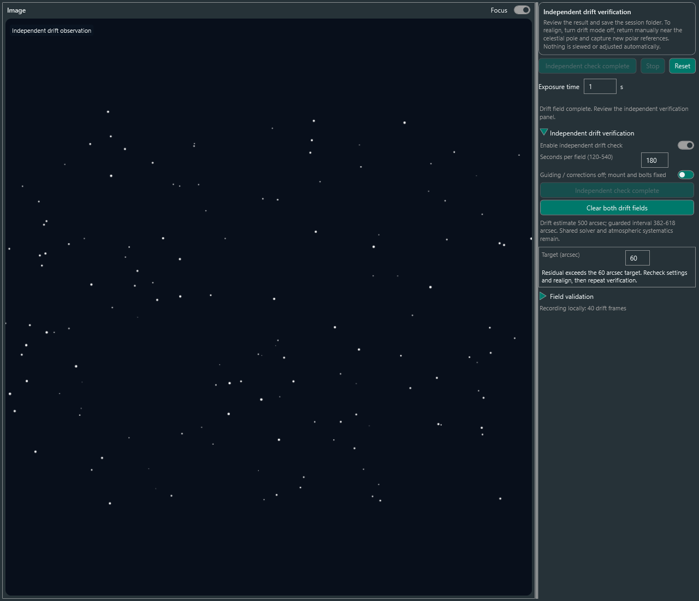

# 독립 드리프트 검증 — 실험 기능

0.1.0.10부터 `Independent drift verification`을 선택할 수 있습니다. 기존 두 위치 RA 회전으로 구한 축을 재사용하지 않고, **항성시 추적 중 두 하늘 위치의 Dec 변화율**로 잔여 극축 오차를 추정합니다. 위치 이동은 사용자가 직접 합니다. 이 검사는 GoTo·축 이동·sync·추적 ON/OFF·가이딩 중지 명령을 보내지 않습니다.

## 사용 순서

1. 극축 정렬을 마치고 Stop 합니다. 선택적으로 `Verify alignment` 재측정과 Stability 결과도 먼저 남기세요.
2. 독립 검증 패널을 펼쳐 사용 옵션을 켭니다. 위치당 관측 시간은 기본 180초이며 120–540초로 바꿀 수 있습니다. 목표 오차는 기본 60″, 범위는 15–600″입니다.
3. 마운트가 주차 해제된 적도의 모드이고 항성시 추적 중인지 확인합니다. **가이딩·디더링·shift tracking·모든 Dec 보정을 끕니다.** 외부 프로그램의 보정도 직접 중지해야 합니다.
4. 적위 0°에서 ±25° 이내, 자오선에서 ±15° 이내, 고도 25° 이상인 별밭으로 직접 이동합니다. 이동과 진동이 끝난 뒤 확인 스위치를 켜고 첫 측정을 시작하세요.
5. 선택한 시간 동안 볼트·마운트·카메라를 고정합니다. 최소 20개의 서로 다른 노출을 plate solve합니다. Streaming 옵션을 켰어도 이 검사는 단일 노출을 사용합니다. 노출·해석·대기 시간 때문에 설정 시간보다 오래 걸릴 수 있습니다.
6. **볼트는 조정하지 않고**, 적위 0° 부근에서 시간각 절댓값 45–75°인 동쪽 또는 서쪽 별밭으로 직접 이동합니다. 고도는 25° 이상이어야 합니다. 고위도에서는 적절한 두 번째 위치를 확보하지 못할 수 있습니다.
7. 추적·가이딩 상태와 고정을 다시 확인하고 두 번째 측정을 시작합니다. 두 위치를 첫 노출부터 마지막 노출까지 30분 이내에 마쳐야 합니다.
8. 판정과 추정 범위를 확인합니다. 재정렬이 권고되면 세션 폴더를 저장하고 독립 모드를 끈 뒤 천구극 근처로 직접 돌아가 새 극축 기준을 촬영하고 볼트를 조정하세요.

독립 모드를 끄거나 Reset하면 해당 독립 검증 결과는 초기화됩니다. 저장된 세션 파일은 남습니다. 관측 중 Stop·오류·연결 변경 시 두 위치 결과를 모두 폐기하고 판정 불가로 표시합니다. 검사 뒤 자동 복귀는 하지 않습니다.

## 판정

- **재정렬 권고:** 재측정 잔여 오차가 목표를 넘거나, 드리프트 추정의 보수적 하한이 목표를 넘습니다. 먼저 장비·설정도 확인하세요.
- **검사 불일치:** 재측정값과 드리프트값이 크게 다릅니다. 가이딩·추적·굴절·카메라 고정 등을 확인하고 반복합니다.
- **판정 불가:** 흔들림이나 추정 불확실성이 크거나, 위치·시간·프레임·장비 상태 조건이 맞지 않습니다. 이를 정렬 불량으로 단정하지 않습니다. 안정된 조건에서 관측 시간을 늘리세요.
- **현재 검사에서 초과 미검출:** 사용 가능한 검사의 검출 한도에서 목표 초과가 검출되지 않았다는 뜻입니다. 절대 정확도 인증이 아닙니다.
- **독립 검증 전:** Stability·RA 재측정만으로 독립 검증을 완료했다고 표시하지 않습니다.

일반 실시간 조정 중 Stability는 수동 시작입니다. RA 재측정 후 Stability는 기본 자동이며 끌 수 있습니다. 독립 드리프트는 별도의 선택 검사로 자동 이어지지 않습니다.

## 계산과 한계

노출 시각의 J2000 plate solution을 N.I.N.A. SOFA로 변환하여 관측 Dec·시간각을 얻습니다(굴절 보정 없음). Dec 변화량을 시간에 선형 회귀하고, 두 위치의 시간각 계수로 작은 극축 오차의 두 성분을 구합니다. 위도와 남반구 부호를 적용하며, 전체 오차를 표시합니다. RA 추적 이동에서 합성한 알려진 축 오차를 이용해 북·남반구 부호와 크기를 검사했습니다.

회귀에는 최소 20프레임·120초가 필요합니다. 프레임 간격은 1–30초, 개별 측정 범위는 최대 600초입니다. 중복·오래된 시각, 영상 크기·반전·픽셀 스케일 변경, 예상 항성시 시간각 변화에서 벗어나는 이동, 큰 산포는 거절합니다. 두 위치가 충분히 떨어지지 않거나 합산 관측이 30분을 넘으면 판정하지 않습니다.

표시 범위는 회귀 표준오차·양의 잔차 상관을 반영한 **3σ 잡음 여유에 30″ 최소 여유를 더한 공학적 가드**입니다. 관측별 잡음 바닥은 max(0.3″, 픽셀 스케일의 0.1배)입니다. **대기·광학계·solver 계통오차에 대해 검증된 신뢰구간이 아닙니다.** 180초의 작은 드리프트만으로 60″ 목표를 확정하지 못할 수 있습니다. 더 긴 관측이나 다른 장비와의 비교가 필요합니다.

기존 축 추정과 계산 원리는 다르지만 카메라와 plate solver를 공유합니다. 대기 굴절·flexure·solver 편향·추적 모델·볼트 이동은 결과에 영향을 줄 수 있습니다. 외부 프로그램의 보정이나 물리적 볼트 조작은 모두 자동 검출할 수 없습니다. 실제 장비에서 정확도와 동작은 아직 검증 전입니다.

## 기록과 오프라인 재계산

디버그 기록을 켜면 독립 검증용 별도 세션에 각 프레임의 관측 좌표·시간각·고도·원래 WCS, 두 회귀 결과, 최종 추정값과 목표·판정을 저장합니다. 각 위치의 처음·마지막 원본 FITS도 가능한 경우 저장합니다. 파일 기록을 꺼도 검사할 수 있습니다.

업데이트한 FieldReview 도구는 `drift_sample`로 회귀와 합산을 다시 수행하고 `review.json`의 `independentDrift`, `driftFrames`에 결과를 내보냅니다. 미완료·취소 기록을 통과 결과로 만들지 않습니다. 기존 `frames.csv`는 극축 기준·조정 프레임만 포함합니다. 재계산 일치는 물리적 정확도 검증과 다릅니다.

관측 위치 선정은 [PHD2 drift alignment 안내](https://openphdguiding.org/man/Tutorials.htm)의 두 위치 관측 방식을 참고했습니다. 이 구현은 PHD2에 연결하거나 코드를 복제한 것이 아니라, N.I.N.A. plate solution의 변화율을 사용하는 자체 코드입니다.

