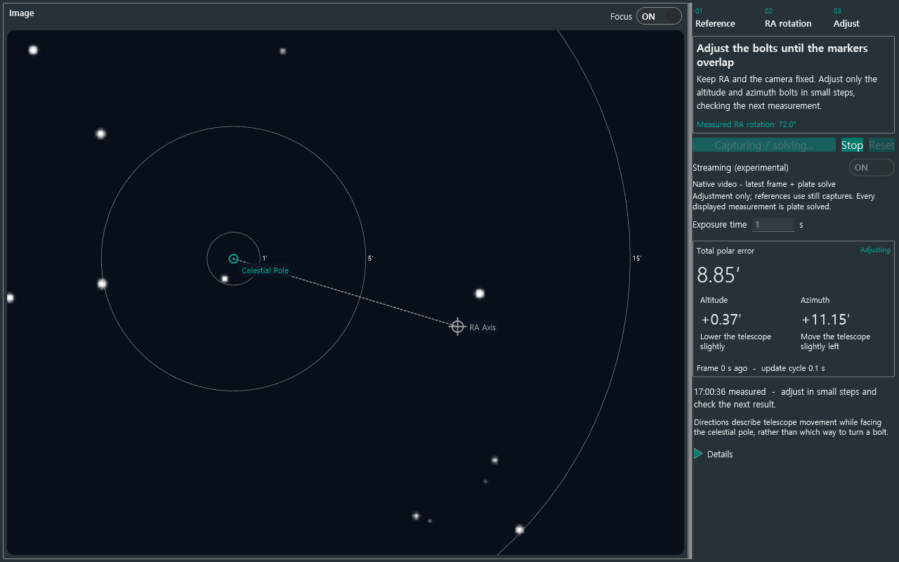

# Streaming review and implementation

The default remains repeated still captures. `Streaming (experimental)` is an opt-in
for the **adjustment** stage. Both calibration references always use still captures.
The first implementation accepts NINA's native ZWO ASI (`ZWOptical_`) and ToupTek
(`ToupTek_`) RAW video paths. ASCOM, DSLR JPEG LiveView, QHY, and other drivers are
not enabled by this option. This is a code-path support boundary, not a list of
hardware-tested models.

## Why it can help

Still mode serializes exposure, transfer, image preparation, solving, and a 250 ms
pause. Streaming receives/converts RAW frames on one producer while the consumer
prepares and plate solves the newest available frame. A capacity-one buffer drops
superseded frames rather than processing an increasingly old queue. There is no
250 ms pause in streaming mode.

A simplified throughput model is `A + P + 0.25 s` per update for still captures,
versus approximately `max(A, P)` for overlapping acquisition A and processing P.
For illustrative A=1.2 s and P=0.8 s, these are 2.25 s and about 1.2 s. These are
scheduling estimates, not measured camera performance. Readout, driver buffering,
CPU contention and solver latency may erase the advantage. Display latency still
includes the age of the selected exposure and its solve duration.

Every displayed alignment measurement still comes from a complete plate solution;
this change does not connect the rigid star-registration core or claim video-rate
alignment. Streaming solves can fail on short/noisy exposures. Use longer exposure
or turn the option off rather than trusting guessed positions. The existing
geometry rejects changed image dimensions, parity and scale; no video resize is
silently treated as a valid calibration.

## Ownership, timestamps and failure

The plugin uses `ICameraMediator.LiveView(sequence, token)` with full frame and the
configured solve binning. It does not open a second SDK connection, slew, or sync.
One task owns enumeration and disposal. Cancellation drains the in-flight native
download before the NINA enumerator calls StopLiveView and before the capture
reservation is released. Native drivers that block indefinitely can still delay
Stop; no concurrent forced disposal is attempted.

The streaming session saves binning, readout mode, gain, offset and ROI, restoring
them for the same connected camera after shutdown. ToupTek asynchronous still-mode
restoration is awaited. Failure is surfaced, guidance is invalidated, and streaming
does not silently switch camera modes or restart still captures.

Video drivers may timestamp download rather than the physical shutter. The initial
streaming path uses receive time minus half the requested exposure as an estimated
midpoint. Camera buffering/transfer latency is unknown. Hardware accuracy and
cadence require real-camera verification; use still captures for final comparison.
The option defaults off and cannot be changed while capture or solving is active.

## Evidence and validation

- NINA 3.2 source: `CameraVM.LiveView(CaptureSequence, CancellationToken)`,
  `ASICamera.StartLiveView/DownloadLiveView/StopLiveView`, and ToupTek video mode.
- Local Manual Focuser source: its public mediator video acquisition and stop
  sequencing, inspected to keep compatible camera ownership behavior.
- [Official NINA imaging documentation](https://nighttime-imaging.eu/docs/master/site/tabs/imaging/#n-imaging)
  distinguishes repeated exposures from camera-dependent LiveView.
- Core tests cover dropped backlog, acquisition continuing before a consumer asks
  for its next frame, draining a cancellation-insensitive download, failure,
  timeout and user cancellation.
- The WPF synthetic harness exercises both modes, repeated stream measurements,
  Stop, stale guidance removal, error handling and language fallback.
- Existing native SOFA/NOVAS integration tests remain in place. No physical camera
  performance, native SDK stop timing, video exposure timestamp, or polar accuracy
  is certified by the synthetic tests.

